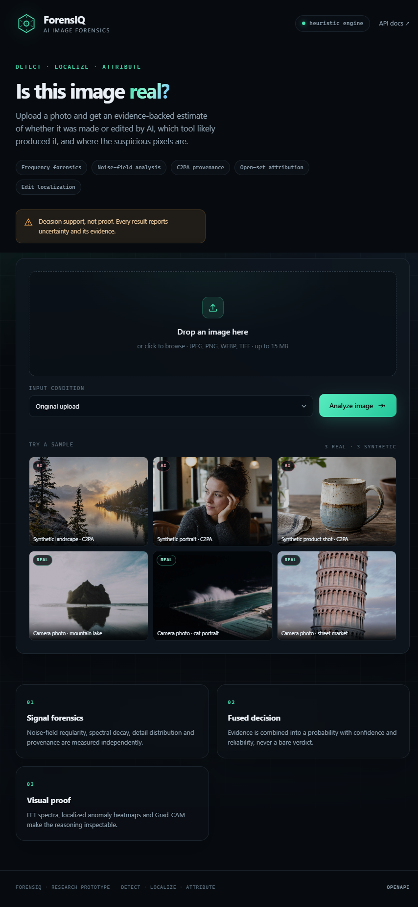
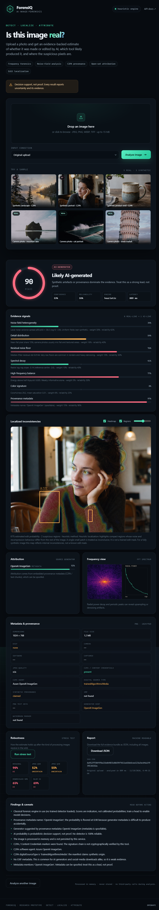

# Image Detector

**Detect, localize and attribute AI-generated images with evidence you can inspect.**

Image Detector is a research prototype answering three questions about an image:

1. **Is it real or AI-generated?** A fused probability with an explicit uncertain band.
2. **Has it been edited?** A localisation heatmap and compact candidate regions.
3. **Which generator made it?** Provenance metadata plus an optional open-set attribution head that can say *unknown*.

Every report exposes the individual signals, their reliability, the frequency spectrum, the heatmap and the provenance evidence. The application never presents a bare verdict: it shows uncertainty, limitations and a decision-support disclaimer.





## Videos

Two 36-second narrated cuts are built from real screenshots of this app:

- [Landscape promo, 1920×1080](docs/promo.mp4) — plays inline if you download it
- [Vertical reel, 1080×1920](docs/reel.mp4)

GitHub serves repository files as downloads and only streams media that is attached to an issue, pull request or comment, so these files link rather than autoplay here. Both are reproducible from the repository: `promo/capture*.mjs` re-takes the screenshots in `promo/shots/` with Puppeteer, `promo/make_video.py` composes the landscape cut, `promo/voiceover.py` synthesises the narration and muxes it in, and `promo/make_reel.py` renders the vertical cut with the same audio track. They need `pillow`, `numpy`, `imageio-ffmpeg`, `edge-tts` and a local Chrome, and expect the app to be running locally.

> **Decision support, not proof.** No statistical detector is reliable enough to judge authenticity on its own. Treat every result as a lead for human review.

---

## What ships in this repository

| Layer | Default (no weights) | With trained weights |
| --- | --- | --- |
| Real vs AI | Nine classical forensic signals, weighted fusion | CLIP embedding + calibrated logistic head, or a small CNN with Grad-CAM |
| Edit localisation | Residual-noise + JPEG error-level inconsistency heatmap | U-Net segmentation of edit masks |
| Attribution | EXIF/PNG/C2PA/watermark markers, 11 known generator patterns | Open-set CLIP attribution head with an `unknown generator` outcome |
| Explainability | Signal table, FFT spectrum, heatmap, region boxes, metadata report | Adds Grad-CAM and U-Net masks |

The repository intentionally does **not** ship trained weights. Models are large, dataset licences differ, and a detector trained on someone else's split is easy to misread. The training pipeline below produces all artifacts reproducibly; drop them into `models/` and the engine picks them up automatically.

### Verified demo results

Measured with the default heuristic engine on the bundled examples (no trained weights). Verdict bands: real ≤ 0.42, uncertain 0.42–0.62, AI ≥ 0.62.

| Example | Truth | Original | JPEG q50 | JPEG q30 | Resize 50% | Blur sigma 2 |
| --- | --- | ---: | ---: | ---: | ---: | ---: |
| `ai_mountain.png` | AI | 0.900 | 0.739 | 0.667 | 0.714 | 0.495 |
| `ai_portrait.png` | AI | 0.951 | 0.821 | 0.780 | 0.553 | 0.575 |
| `ai_product.png` | AI | 0.918 | 0.820 | 0.797 | 0.824 | 0.530 |
| `real_cat_portrait.jpg` | Real | 0.103 | 0.141 | 0.117 | 0.170 | 0.403 |
| `real_mountain_lake.jpg` | Real | 0.403 | 0.562 | 0.249 | 0.450 | 0.478 |
| `real_street_market.jpg` | Real | 0.275 | 0.433 | 0.285 | 0.365 | 0.415 |

Across all 30 conditions this is 22 correct, 8 uncertain and 0 confident errors. The uncertain cases are the hardest photographs after recompression, downscaling or blur, plus renders after heavy blur or half-resolution resampling; heavy blur removes the noise-field and high-frequency evidence the engine relies on and resampling erases the pixel-grid trace, so it abstains instead of guessing.

Partially edited images (for example a real photo with an AI-replaced face expression) are also covered: when the upload is lossless or JPEG q95+, a compact region whose noise and recompression behaviour differs from the rest of the frame raises the probability into the AI band, even if the rest of the photo is authentic. JPEG below roughly q95 spreads block noise that mimics this cue, so the local-edit check is skipped there and the report says so.

The three synthetic examples carry OpenAI ImageGen C2PA provenance, so the original verdict is floored at 0.90 and attribution reports **OpenAI ImageGen** from metadata. Simulated recompression strips that metadata, which is why the same images fall back to classical evidence. This is an honest demonstration of both the value and the fragility of provenance, not a benchmark.

Reproduce with:

```bash
python -m aiforensics batch src/aiforensics/api/examples --json examples-report.json
```

---

## Architecture

```text
Upload / CLI path
      |
      v
 Preprocessing ................ decode, EXIF orientation, size limits,
 (preprocessing.py)             analysis (<=1024 px) and display copies
      |
      +--> Metadata & provenance ........ EXIF, PNG text, XMP, C2PA/JUMBF,
      |    (metadata.py)                   JPEG quality, watermark markers
      |
      +--> Classical evidence ........... noise heterogeneity, detail mix,
      |    (analysis/heuristic.py)         noise floor, spectral decay, HF,
      |                                     colour signature, provenance
      |
      +--> Trained detector (optional) ... CLIP linear head or CNN
      |    (analysis/detector.py,          (Grad-CAM when CNN)
      |     analysis/cnn_detector.py)
      |
      +--> Attribution (optional) ........ open-set head on CLIP features
      |    (analysis/attribution.py)        + metadata hint
      |
      +--> Edit localizer ................ heuristic heatmap or U-Net
           (analysis/localization.py,
            analysis/localizer_model.py)
      |
      v
 Fusion & calibration ................ 75% model weight when a trained
 (core/fusion.py)                       head exists, otherwise heuristic;
                                         uncertainty band + confidence
      |
      v
 Explainable report ................... verdict, signals, heatmap, boxes,
 (schemas.py, explain/)                 spectrum, Grad-CAM, metadata notes
      |
      +--> Web UI, JSON API, CLI, batch report
```

**Decision bands.** `P(AI) <= 0.42` is reported as real, `0.42 < P(AI) < 0.62` as uncertain, and `P(AI) >= 0.62` as AI-generated. The API also returns `confidence` (1 minus normalised binary entropy) and `reliability`, which reflects how much trustworthy evidence was available.

**Signal weights** in the classical engine: noise heterogeneity 0.405, pixel-grid periodicity 0.188, detail distribution 0.166, provenance 0.099, local edit consistency 0.040, residual noise floor 0.034, spectral decay 0.034, colour signature 0.023, high-frequency balance 0.011. Each weight is further scaled by a per-signal reliability before fusion, so a weak cue cannot dominate. A separate decision rule raises the probability into the AI band when a compact local inconsistency is strong on a lossless or q95+ upload.

---

## Quickstart

Requires Python 3.10+ (tested on 3.12 and 3.14). The runtime has no GPU or model-download requirement.

### Windows

The bundled launcher avoids the broken Microsoft Store `python` alias:

```bat
run.bat
```

It starts the server at <http://127.0.0.1:8000>. If that port is already taken, the server automatically uses the next free port and prints the URL. Pass a CLI command to run anything else:

```bat
run.bat info
run.bat analyze path\to\image.jpg
run.bat serve --port 8765
```

Alternatively use PowerShell: `.\run.ps1 serve`. For an isolated environment, run the setup script once (it creates `.venv` and installs dependencies; no activation step is needed):

```bat
setup.bat
run.bat
```

Manual equivalent:

```bat
py -3 -m venv .venv
.venv\Scripts\python.exe -m pip install -e ".[dev]"
.venv\Scripts\python.exe -m aiforensics serve
```

`run.bat` and `run.ps1` automatically use `.venv` when it exists. Do not call bare `python` for setup on Windows unless it is already a real installation; use `py -3` as shown. If you do want to activate the environment: `.venv\Scripts\activate` in cmd, or `.venv\Scripts\Activate.ps1` in PowerShell.

### macOS / Linux

```bash
sh run.sh                 # serves on port 8000 (or the next free port)
sh run.sh analyze image.jpg
```

Or install the package:

```bash
python3 -m venv .venv
source .venv/bin/activate
python -m pip install -e ".[dev]"
python -m aiforensics serve
```

Open the URL printed by the launcher (normally <http://127.0.0.1:8000>). Upload an image or click one of the six bundled examples. Reports can be downloaded as JSON.

> If `python` opens the Microsoft Store instead of running, use `py -3` or the launchers above. This is a Windows alias issue, not a project issue.

> On machines with Application Control / AppLocker policies, scikit-learn 1.9.x can fail with `DLL load failed ... An Application Control policy has blocked this file`. `setup.bat` detects this and installs the known-good 1.8.0 build automatically. To do it manually: `.venv\Scripts\python.exe -m pip install --force-reinstall "scikit-learn==1.8.0"`.

### CLI

```bash
python -m aiforensics analyze image.jpg --json report.json
python -m aiforensics analyze image.jpg --distortion jpeg30
python -m aiforensics batch ./photos --json batch.json --limit 50
python -m aiforensics info
python -m aiforensics serve --host 0.0.0.0 --port 8000
```

Distortions (`none`, `jpeg50`, `jpeg30`, `resize50`, `blur2`) simulate real-world handling and are useful for stress testing. The analysed copy is reported in `distortion`.

### API

| Method | Path | Purpose |
| --- | --- | --- |
| `GET` | `/api/health` | Engine mode, model availability, uptime |
| `GET` | `/api/examples` | Bundled example images |
| `POST` | `/api/analyze` | Multipart upload: `file`, optional `distortion` |
| `POST` | `/api/analyze/example/{name}` | Analyse a bundled example |
| `POST` | `/api/analyze/batch` | Up to 8 uploads in one request |
| `GET` | `/docs` | OpenAPI/Swagger UI |

```bash
curl -F "file=@image.jpg" -F "distortion=none" http://127.0.0.1:8000/api/analyze
```

Errors are JSON: `{"error": "unsupported_format", "message": "..."}`. Uploads are limited to 15 MB, 50 megapixels and JPEG/PNG/WebP/BMP/TIFF. Batch requests cap at 8 images and report per-file errors without aborting the batch.

### Docker

```bash
docker build -t image-detector .
docker run --rm -p 8000:8000 image-detector
# Optional trained artifacts:
docker run --rm -p 8000:8000 -v "$PWD/models:/app/models" image-detector
```

The image runs as a non-root user and exposes a health check on `/api/health`.

### Configuration

| Environment variable | Default | Meaning |
| --- | --- | --- |
| `IMAGE_DETECTOR_MODEL_DIR` | `models/` | Directory for all four artifacts |
| `IMAGE_DETECTOR_DETECTOR_PATH` | `<model_dir>/detector.joblib` | CLIP linear detector |
| `IMAGE_DETECTOR_ATTRIBUTION_PATH` | `<model_dir>/attribution.joblib` | Attribution head |
| `IMAGE_DETECTOR_CNN_PATH` | `<model_dir>/cnn_detector.pt` | CNN detector |
| `IMAGE_DETECTOR_LOCALIZER_PATH` | `<model_dir>/localizer.pt` | U-Net localizer |
| `IMAGE_DETECTOR_CLIP_MODEL` | `openai/clip-vit-base-patch32` | CLIP backbone id |
| `IMAGE_DETECTOR_CLIP_DEVICE` | `auto` | `auto`, `cpu` or `cuda` |

The CNN takes precedence over the linear head when both exist. Missing or failed artifacts degrade gracefully to the classical engine and say so in the report.

---

## Training and evaluation

Training dependencies are separate because they pull PyTorch and Hugging Face:

```bash
pip install -e ".[train]"
```

The pipeline is manifest-driven. Generator-disjoint splits are the default: whole AI generators are assigned to train/val/test so the test set measures generalisation to unseen generators instead of memorised fingerprints. If a manifest already defines splits, those are respected.

### 1. Build a manifest

```text
data/
  real/                 # COCO / ImageNet / camera photos, licensed for your use
  sdxl/                 # images generated with SDXL
  flux/                 # images generated with FLUX
  sd3/                  # images generated with SD3
```

```bash
python -m aiforensics.training.manifest \
  --out data/manifest.csv \
  --real data/real \
  --ai SDXL=data/sdxl \
  --ai FLUX=data/flux \
  --ai SD3=data/sd3 \
  --force
```

The CSV columns are `path,label,generator,split,mask`. Paths are stored relative to the manifest. With fewer than three generators, the builder refuses to create generator-disjoint splits; add generators or provide your own split column before training.

### 2. Extract CLIP features

```bash
python -m aiforensics.training.clip_features \
  --manifest data/manifest.csv \
  --out data/features.npz \
  --batch-size 16
```

### 3. Train the detector and attribution heads

```bash
python -m aiforensics.training.train_detector \
  --features data/features.npz \
  --out models/detector.joblib

python -m aiforensics.training.train_attribution \
  --features data/features.npz \
  --out models/attribution.joblib
```

The detector head is standardised logistic regression with balanced class weights, a validation-tuned threshold and Platt calibration. The attribution head is multiclass logistic regression with an open-set confidence floor: when no class clears the floor, the report says `unknown generator` instead of forcing a name. If validation contains only unseen generators, the floor is estimated from out-of-fold training confidences.

### 4. Train the CNN detector (optional)

```bash
python -m aiforensics.training.train_cnn \
  --manifest data/manifest.csv \
  --out models/cnn_detector.pt \
  --arch smallcnn \
  --epochs 10 \
  --size 256 \
  --batch-size 16
```

`--arch convnext_tiny --pretrained` requires `torchvision`. Mixed precision activates only on CUDA. The checkpoint stores architecture, width, normalisation, metrics and training history, so inference does not depend on CLI flags.

### 5. Build edits and train the localiser (optional)

```bash
python -m aiforensics.training.make_edits \
  --source-manifest data/manifest.csv \
  --images-out data/edits \
  --masks-out data/edit_masks \
  --out-manifest data/edits.csv \
  --per-image 2 \
  --real-only

python -m aiforensics.training.train_localizer \
  --manifest data/edits.csv \
  --out models/localizer.pt \
  --size 512 \
  --epochs 15
```

Synthetic edits (paste, blur, colour shift, noise) come with pixel masks. Replace them with CASIA/Columbia masks where licences allow for a stronger localiser. The U-Net uses BCE + Dice loss and checkpoint selection by validation IoU.

### 6. Evaluate the full engine

```bash
python -m aiforensics.training.evaluate \
  --manifest data/manifest.csv \
  --splits val test \
  --output reports/evaluation.json
```

The report contains accuracy, precision, recall, specificity, F1, balanced accuracy, ROC-AUC, Brier score, ECE, confusion matrices, per-generator detection rates, attribution top-1 and unknown-rejection rates, edit statistics, and robustness sweeps over JPEG q50/q30, 50% resize and Gaussian blur.

Optional dataset synthesis:

```bash
python -m aiforensics.training.generate --model stabilityai/sdxl-turbo --out data/sdxl --count 64
python -m aiforensics.training.generate --model black-forest-labs/FLUX.1-schnell --out data/flux --count 64
```

These require `diffusers`/`accelerate`, sufficient VRAM and model access. See [docs/DATASETS.md](docs/DATASETS.md) for dataset suggestions, split policy and licence notes.

---

## Reproducibility

- Fixed seeds are passed to scikit-learn, PyTorch, NumPy and Python's `random`.
- Splits are generated once and written to the manifest; every stage reads the same CSV.
- Each artifact embeds creation time, seed, training generators, threshold source and metrics.
- Evaluation uses the real engine path, including metadata, fusion and localisation.
- Demo results in this README were produced by the commands above on the bundled examples.

## Tests

```bash
PYTHONPATH=src python -m pytest
```

The suite covers preprocessing and validation, metadata/C2PA extraction, signal fusion and localisation, engine caching and distortion notes, manifest splitting and training utilities, API endpoints and security headers, and the CLI. It deliberately uses synthetic images; it does not claim model accuracy.

## Project layout

```text
src/aiforensics/
  api/            FastAPI app, static SPA, bundled examples
  analysis/       heuristic, CLIP, detector, attribution, CNN, U-Net
  core/           engine orchestration and fusion
  explain/        heatmaps, overlays, FFT spectrum rendering
  training/       manifest, features, training, edits, evaluation, generation
  config.py       paths and limits
  metadata.py     EXIF/PNG/C2PA/provenance extraction
  preprocessing.py
  schemas.py
tests/
docs/             assets, model card, and the promo/reel videos
promo/            screenshot capture and video build scripts
models/           trained artifacts (not committed)
run.bat / run.ps1 / run.sh   launchers (prefer .venv when present)
setup.bat         one-command Windows environment setup
```

## Limitations and ethics

- The default engine is heuristic. Its scores are indicators, not calibrated probabilities; train and evaluate heads on your own generator-disjoint split before making decisions.
- Metadata is trivially stripped or spoofed. C2PA claims are read but signatures are **not** verified, and watermark markers are not validated.
- Recompression, resizing, blur and screenshots erase the high-frequency evidence these methods rely on. Provenance metadata usually disappears first.
- Detectors generalise poorly to unseen generators and can be biased by dataset artefacts, post-processing and content. The open-set attribution head is designed to abstain, but abstention is not a guarantee.
- Edit localisation is not a forensic reconstruction. Regions are candidate evidence requiring human review.
- The service processes images in memory and keeps only a bounded in-process cache. It does not persist uploads, but it also cannot guarantee deletion from your reverse proxy, browser or logs.
- Do not use this tool as the sole basis for accusations, moderation decisions, journalism or legal conclusions. Communicate uncertainty and seek corroborating evidence.

Model risks, intended use and evaluation caveats are documented in [docs/MODEL_CARD.md](docs/MODEL_CARD.md).

## License

MIT. See [LICENSE](LICENSE).
